<p align="center">
  
</p>

<h1 align="center">DiskSweep</h1>

<p align="center">
  <strong>Fast, utilitarian storage capacity monitor and zero-harm system cleanup utility for Windows.</strong>
</p>

<p align="center">
  <a href="https://github.com/justacouplethings/DiskSweep/releases/tag/v1.1.0"></a>
  
  
  
  <a href="LICENSE"></a>
</p>

---

## 🚀 Overview

**DiskSweep** is built for power users who demand clear visibility over their drives and swift, non-destructive junk removal. Inspired by classic Windows engineering utilities like **WinDirStat**, **RAMMap**, and **Process Hacker**, DiskSweep brings high-density, utilitarian productivity with native hardware acceleration, modern dark themes, and zero fluff.

- **Storage Capacity & Health**: Instant inspection of all active local, external, and removable drives with color-coded health meters and dedicated, non-colliding volume headers.
- **High-Speed Clean Engine**: Throttled parallel deletion prevents UI lag, executing swift deletions across temp, caches, error dumps, and Windows Update downloads.
- **Rock-Steady Real-Time Feedback**: Multi-column telemetry separates live freed byte counters from changing filenames, eliminating text jitter during cleaning.
- **Personalized Visual Themes**: 4 built-in high-contrast themes (Charcoal Dark, OLED Pure Black, Midnight Navy, and Matrix Green) with live dynamic switching.
- **Safety Cushion & Recycle Bin Options**: Configurable 24-hour safety cushions, Recycle Bin fallbacks, and confirmation gates.
- **Top Space Hogs Analyzer**: Quickly finds the top 100 largest files on any drive with quick Explorer and Recycle Bin actions.
- **Always Elevated**: Pre-configured with native UAC manifest (`requireAdministrator`) to ensure full read/write access to system-level temp and diagnostic directories.

---

## ⚡ Quick Start (Portable)

No installation required. 

1. Download [`DiskSweep-v1.1.0-Portable.zip`](release/DiskSweep-v1.1.0-Portable.zip) from the repository.
2. Extract the archive anywhere (Desktop, USB drive, or Utilities folder).
3. Run `DiskSweep.exe` (or launch via `run.bat`).

*(Requires Windows 10/11 and .NET 10 Desktop Runtime)*

---

## 🎨 Built-In Themes

DiskSweep includes 4 custom-crafted themes switchable live from the **Settings** tab:

1. **Charcoal Dark** (Default): Classic Visual Studio dark palette (`#181818` / `#007ACC`).
2. **OLED Pure Black**: True deep black (`#000000`) with vibrant neon mint accents (`#00FF9D`).
3. **Midnight Navy**: Nord-inspired cyber night navy (`#0B0F17` / `#3B82F6`).
4. **Matrix Green**: High-contrast terminal emerald dark (`#060A06` / `#10B981`).

---

## 🔍 Features in Detail

### 1. Drive Capacity & Health Meters
- Real-time enumeration of all attached drives.
- Dynamic color-coded capacity meters:
  - 🟢 **Healthy**: > 20% free space remaining
  - 🟠 **Warning**: 10% – 20% free space remaining
  - 🔴 **Critical**: < 10% free space remaining
- Non-colliding responsive layout displaying total storage pool, free capacity, filesystem (NTFS, FAT32, exFAT), and volume labels.
- One-click context menu to explore drives in File Explorer or launch Windows Disk Management / Storage Sense.

### 2. Multi-Target Safe Cleanup Engine
Cleans junk without breaking Windows or user applications:
- **System Temporary Files**: `%TEMP%`, Windows System Temp (`C:\Windows\Temp`), and Prefetch traces.
- **Windows Updates & Diagnostics**: Downloaded Windows Update cache (`SoftwareDistribution\Download`), Windows Error Reporting (WER) logs, user-mode crash dumps, and BSOD kernel minidumps.
- **Graphics & Shader Caches**: DirectX 11/12 GPU caches (`D3DSCache`), NVIDIA DXCache/GLCache, and AMD Radeon shader pipelines.
- **Web Browser Caches**: Google Chrome, Microsoft Edge, Brave Browser, Mozilla Firefox, Opera, and Opera GX HTTP and GPU caches (passwords, logins, and history are never touched).
- **Application & Gaming Caches**: Discord media and code caches, Steam CEF browser cache, Spotify stream cache.
- **Developer Package Caches**: Python Pip cache, Node.js NPM cache, and Rust Cargo registry cache.
- **Windows Recycle Bin**: Integrated shell API to query and empty discarded items across all volumes.

### 3. Space Analyzer (Large Files)
- Scans any selected drive for the top 100 largest files.
- Configurable minimum size filter (25 MB, 50 MB, 100 MB, 250 MB, 500 MB, 1 GB).
- Sorts by size and displays file name, extension, last modified date, and path.
- Context menu allows moving large forgotten files directly to the Recycle Bin or jumping to their folder in Explorer.

### 4. Interactive Execution & Audit Log
- Rock-steady status bar displaying live freed bytes and deleted item counters in dedicated, fixed-width columns.
- Monospace execution console recording every operation, deleted count, locked items skipped, and exact bytes reclaimed.

---

## ⌨️ Keyboard Shortcuts

| Shortcut | Description |
|---|---|
| `F5` | Start System Scan |
| `Ctrl + R` | Refresh Drives and Storage Statistics |
| `Ctrl + A` | Select All Cleanable Targets |
| `Ctrl + ,` | Open Settings & Personalization |
| `Esc` | Cancel Active Scan or Deletion |
| `F1` | About DiskSweep |

---

## 🛠️ Building from Source

```cmd
git clone https://github.com/justacouplethings/DiskSweep.git
cd DiskSweep
dotnet build -c Release
```

The output binary will be located at:
`bin\Release\net10.0-windows\DiskSweep.exe`

---

## 📄 License

Distributed under the [MIT License](LICENSE).
